# MY READ ME FILE 
Here is where i will be documenting the development of my website as well as the all weekly tasks that i am assigned. 

## Week 1 
In todays seminar during hour 2 were tasked with the following: 

### - Create your first web page (in this class)

#### Pick one topic:
Intro about yourself, styling & organising a poem, song lyrics, book fragment, etc.
Think about how you want to represent your personality or the selected text as a web page
use CSS text styling elements, incl. font-face, font, colours, etc.

In class i used the demo code and started by first doing a little introduction about myself and then alter the colour of the background and the font of the website header. 

This is the colour scheme i decided to use i, i wanted to use these colours as i felt like they contrasted eachother well whilst still looking appealing, i also liked that they came with their hex code this made it easier for mw to actually change the colour of things. 

The colour pallet:
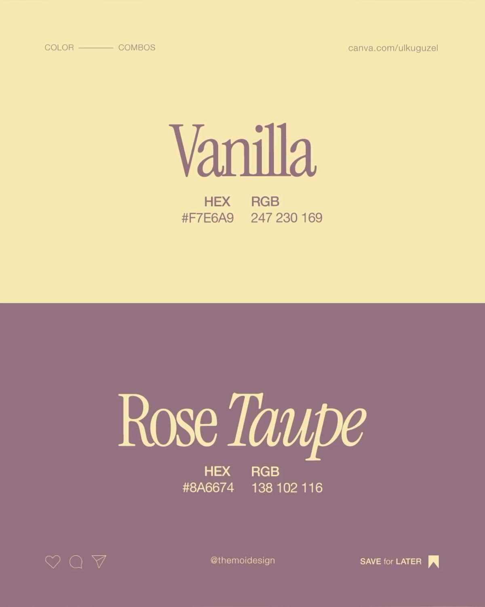

The code:
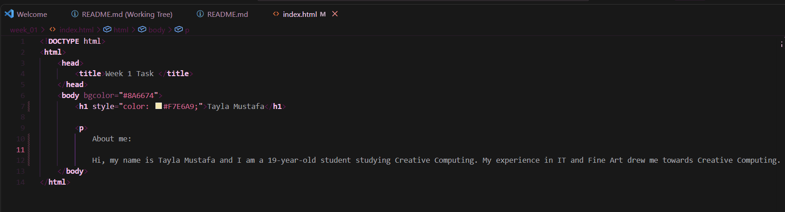 

The webpage so far:
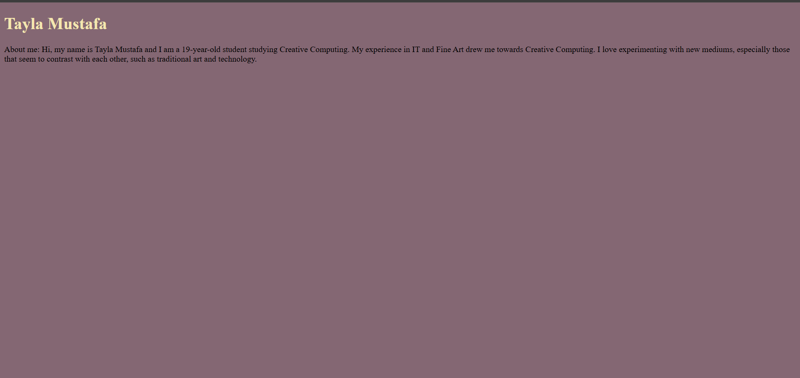 

After i did this i next i needed to change the font of my text,i first go on google fonts to look at what styles whould suite ny portfolio website best, i wanted something that matched the font used on the colour pallet image and found this font that was similar 

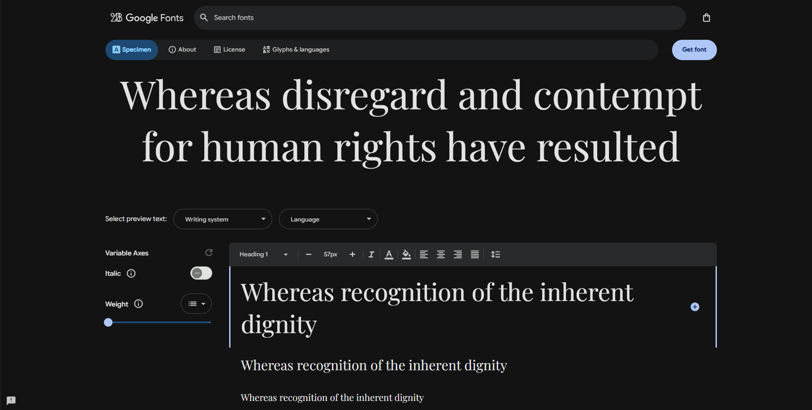 

i clicked get font and then i got the embeded code for HTML that google provides and incerted it into my code 

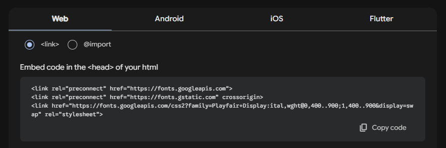 

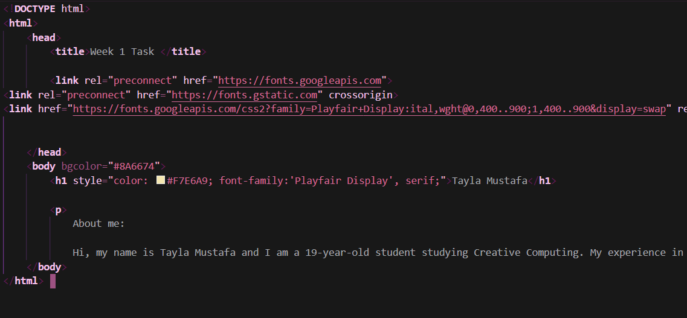 

This has now changed the apperance of my introduction and title: 
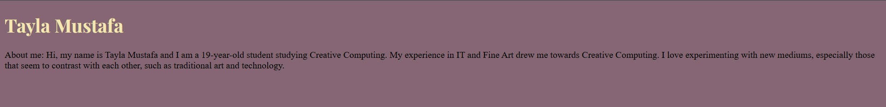 

## sources used to help change fornt: 
https://www.youtube.com/watch?v=g15mF_XAOB8
https://www.w3schools.com/tags/tag_font.asp

#### Now that the in class task is completed i can begin week 1s work 
Make a copy of the task from Hr 2. Make at least 1 new version of it and make the text easy to read according to the guidelines from resources below.

Think about:
- font size

- colours 

- contrast

- line length

- line spacing

- semantic structure: include at least section, 2 header levels, paragraph tags.

- Add an image to the page and ensure to add alt text.

In the documentation, include ~200 words on: 
screenshots of the different page versions
a description of what you did
a reflection on how the accessibility & readability of your page changed.

Points of improvements: 

As someone who is dyslexic there are some immediate factors that can be altered to make it a little more accessible. 

- text size 
- text placement/site structure 
- line spacing 
- font 
- potentially colour pallet

### Text size 
Currently my web page title and about me section is quite small, this makes it hard to see what is written and hard to navigate the site. 

I first changed the size of my header i experimented with a few diffrent sizes 

#### Size 90px: 
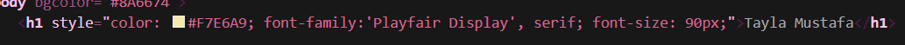 

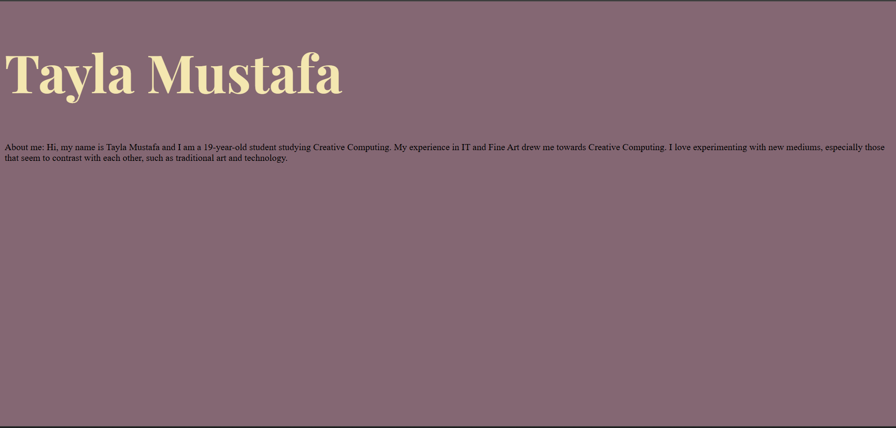

#### Size 80px: 

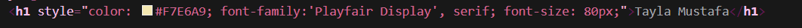

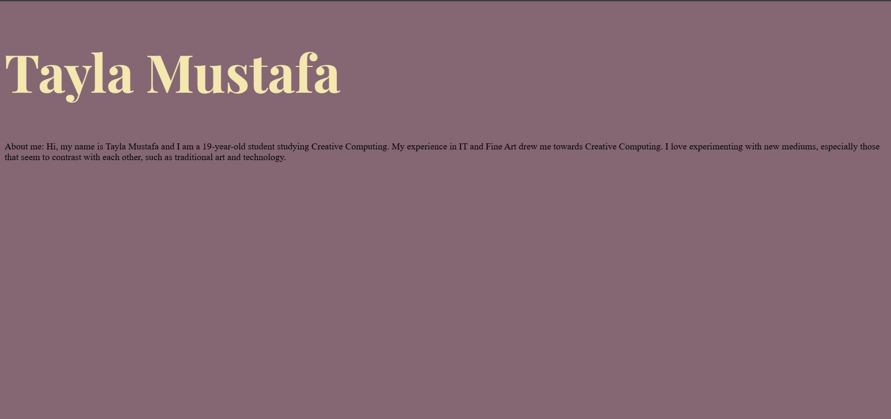

#### Size 60px:
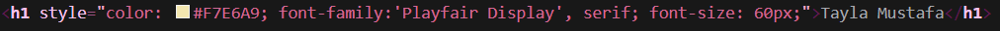

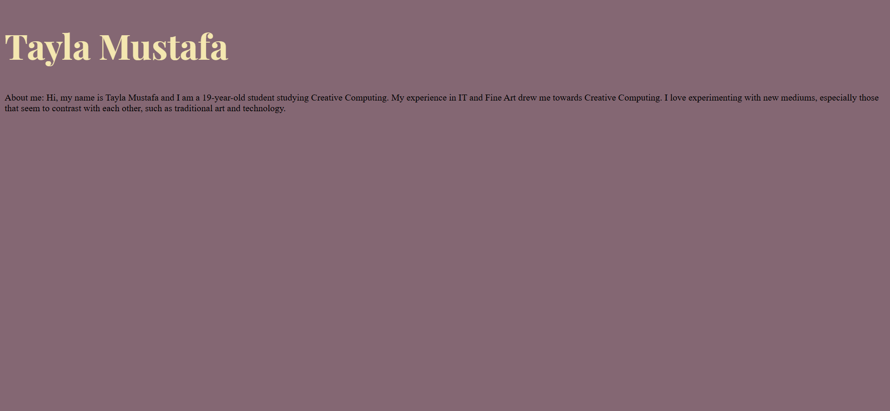

After experimenting with a few diffrent sizes i have decided to make my header 90px size as 80xp doesnt make a crazy diffrence sizewise compared to the 90px and the 60px is too small 

Now im going to change the text size of my about me section similar to my title ive tested out a few diffrent sizes 

#### Size 35px: 
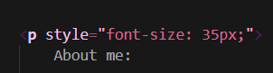
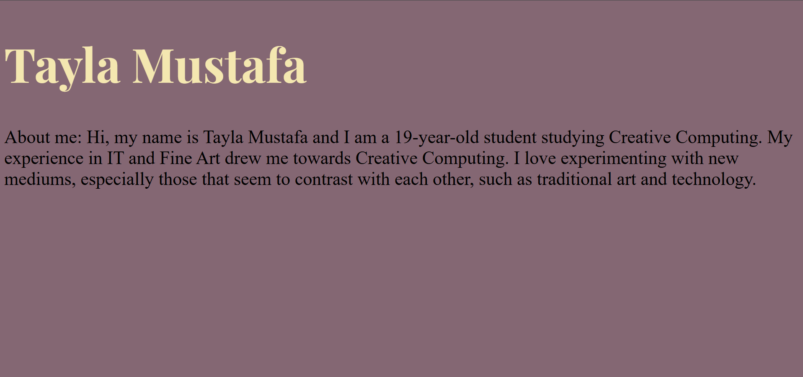

#### Size 25px: 
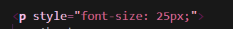
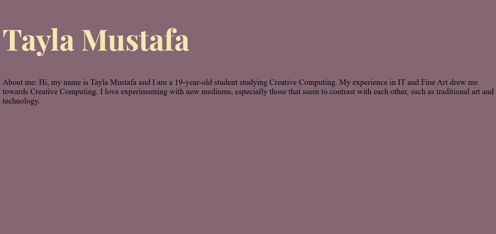

#### Size 15px: 
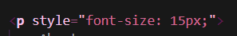
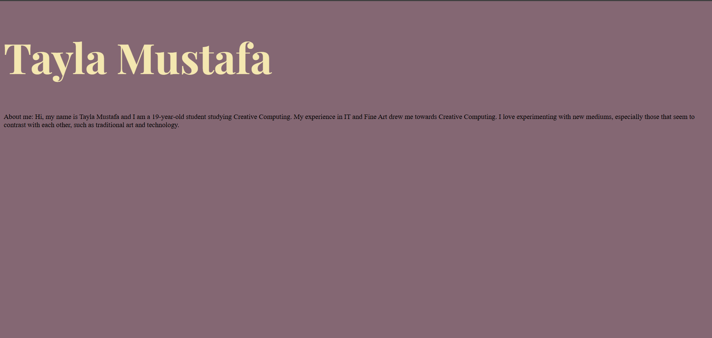

After experimenting with a few diffrent font sizes i decided to go for the 35px as its the biggest and clearest to see, although the 25px isnt considerable different from the 35px i do believe porpotionately it doesnt look the best on the screen additionally the 15px is way too small, is hard to read and isnt much diffrent compaired to the origional text size. 

### Line length

Now that ive changed the font size and made the whole about me section more readable now i can start to alter the text placemet/line length. 
This will help make the site look more professional and more put together. 

To start i want to shorten my line length so that the introduction doesnt streach across the whole of my page. 

To do this i first started by introducing a max width, this will controll how far the text will strech across the screen, i then made the max width 45 characters, i then made the text align to the left so that the text stays to the left side of the screen. 

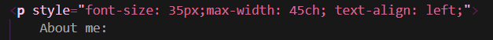

### Line spacing 
Now i need to alter the line spacing in my introduction, to do this i got to my paragraphy tag and add the line height and then experimented with diffrent sizes  

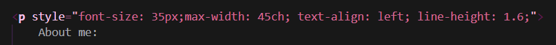

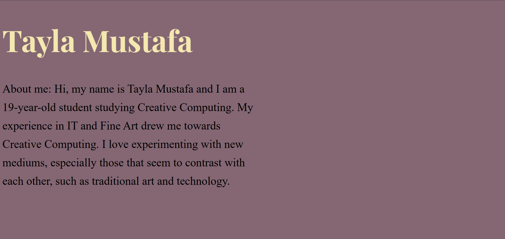

#### Line length 1.5 

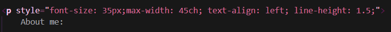

#### Line Length 1.4 

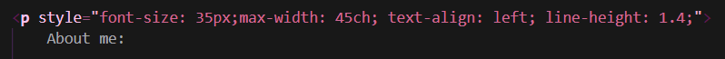

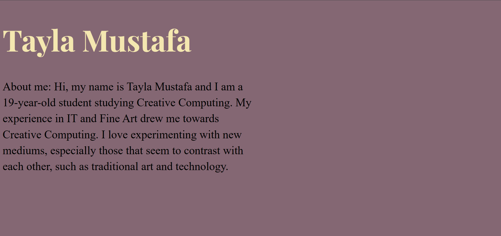

After testing a few diffrent sizes ive decided to go with the 1.5 as it makes the text a lot easier to read without having the text take up the whole page. 

### Page structure and Organisation 

Now i need to organise the page and give the website more of a structure, my code already has 1 heading and paragraph, however to follow todays task i need to add another heading and a section tag. 

i start by putting a section tag above the first heading and last paragraph tag, i them made the About me: within my paragraph into a second heading by putting < h2 > nect to it. after doing this, this is what my webpage looks like. 

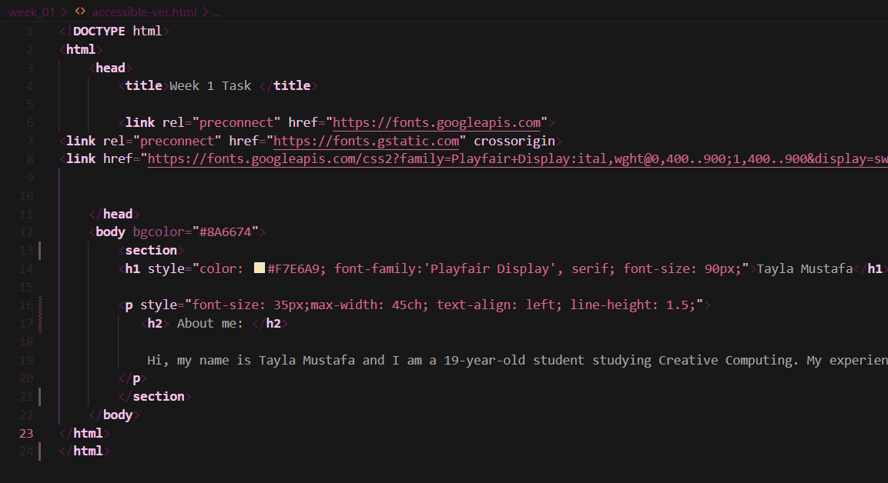
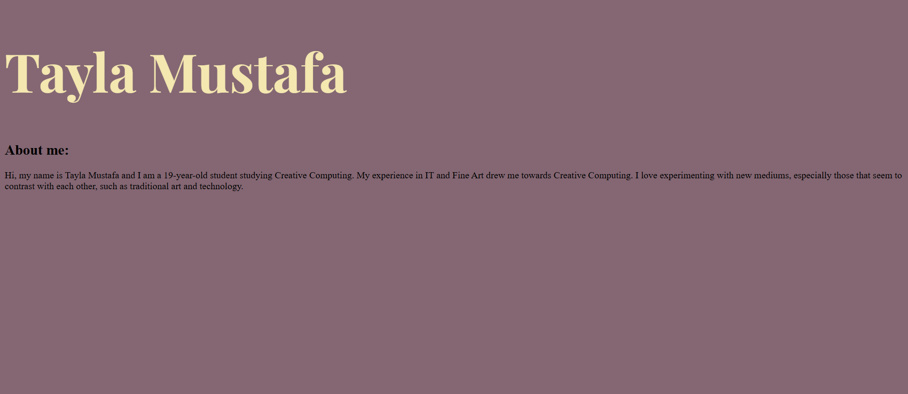

After making these changes ive ran across a few issues:
- text runs across the screen 
- text is now smaller 
- no more text spacing as the text now runs across the screen 

After looking at my code i realised that this was happening due to me keeping the about me heading with my paragraph section to fix this i jost moved the about me under the fist heading (above the paragaph)

#### Now this is what the webpage is looking:

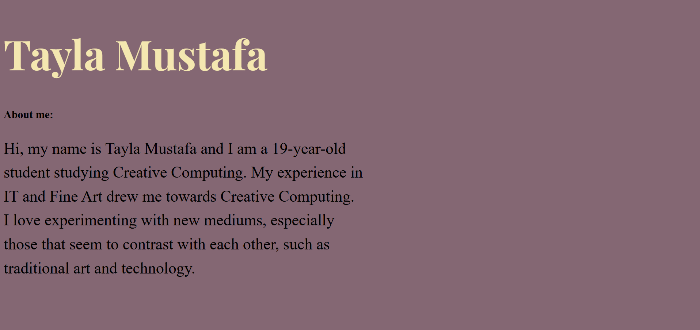

Now that things are back to normal i want to alter the text size of the about me heading just so that its a little clearer 

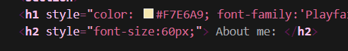
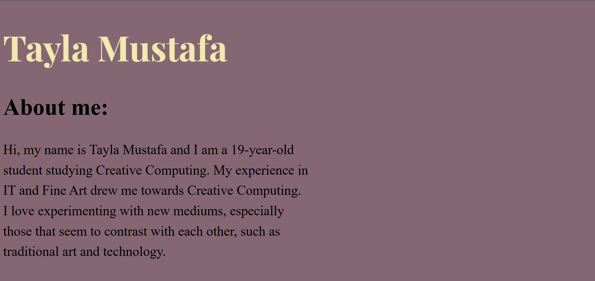

Now that i can clearly differentiate between header1,2 and the paragraph i want to fix the spacing between the paragraph and about me header, i think the gap between the two makes the page look seperated and overall disorganised. To fix this i introduced a margin top to my paragraph styling, this will bring the text closer to the header and a margin bottom to the 2nd header to get rid of the extra space below the heading 

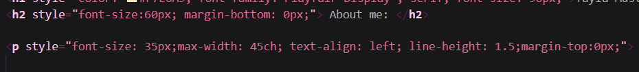

### Colour Contrast 
Now i need to alter the colour scheme of my site so that the information on the site is easier to read. 
Its suggested that soft colours with a high contrast text works best for accessibility and improves the visibility of information on sites.

Currrently i have a very soft colour scheme with low contrast which may make reading the difficust. To check if theres enough of a contrast between the two colours i used this site: https://webaim.org/resources/contrastchecker/ 

This is a contrast checker that helps identify how readable text will be agaist certain background colours and compairs the contrast to the web accessibility standard, this is an extremely helpful tool as it allows me to make a more conciouse decision based off of the readability of the text rather tjan the aesthetics of the site. With the help of this tool i can now make the needed changes to make the website more accessiblt to those with learning diffrences or visual imapirments. 

I first started by testing the contrast between the my first header and the background colour

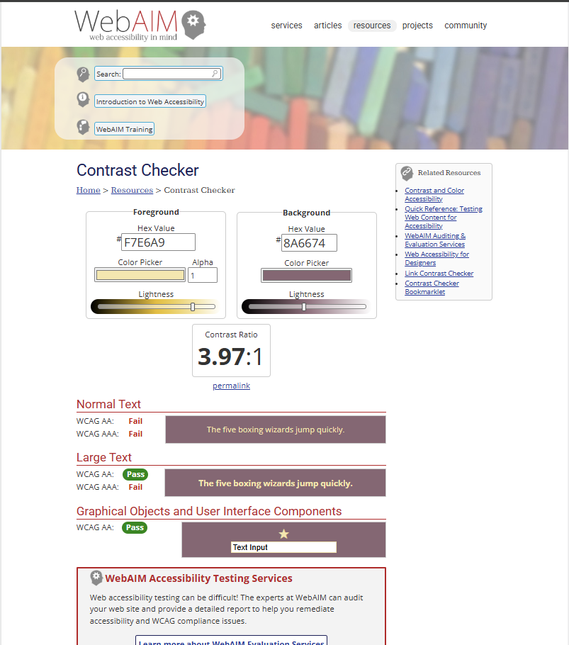

This shows that the yellow colour passes for larger fonts which is perfect for my header, however this font colour wouldnt work for smaller text like my about me section. 
As the colour passed the contrast test for larger text ive decided to keep the colour of my first header the same. 

Next i tested the contrast between the black text (about me section) to the background 
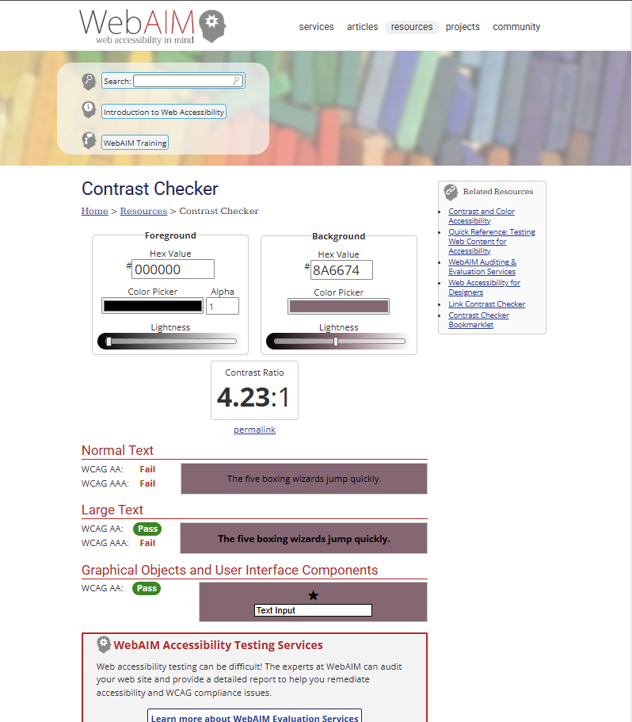

The black did not pass the contrast text for small text so that needs to be changed, as softer colours are prefered i wanted to see how white would test incomparison to the black 

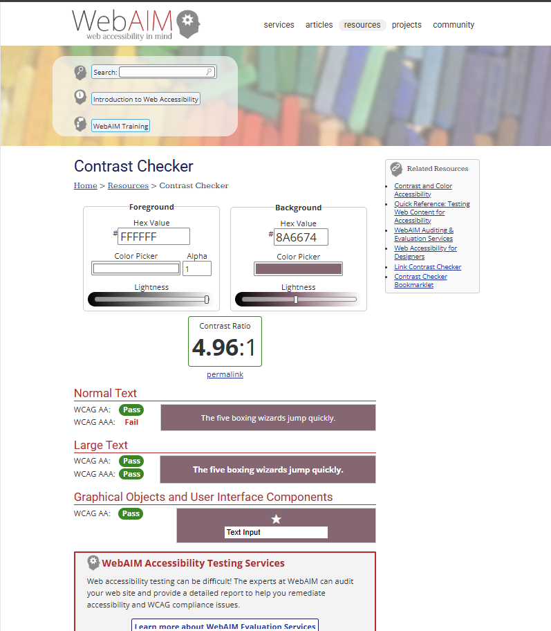

Based of off the results, white scores way higher in comparison to the black so ive decided to change my intro text to white to imporove the readability of the text abd the overall accessibility of the site 

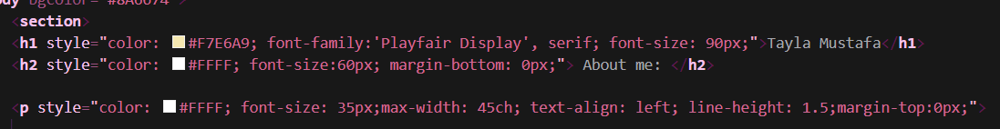

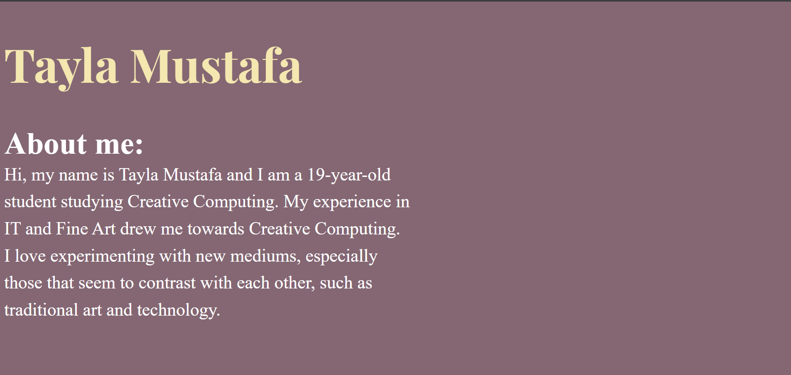

### Adding an image 
Now i need to add an imaage i intentially left a lot of blank space on the right side of my site as i really liked the layout of this website i saw on pinterest and wanted to do something similar to it 

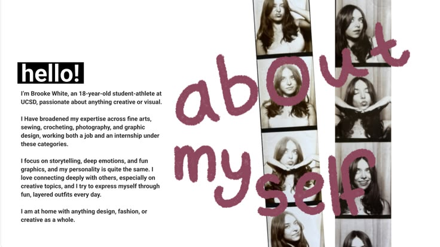

I found this lace heart on this site: 

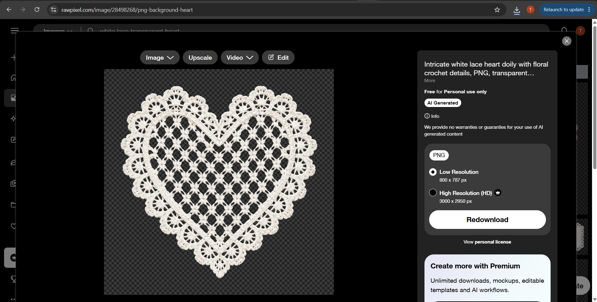

To put the image in i forst start by adding a image tag in my section area of my code, unlike a regular image tag i have to use ../ at the begining of mine, this will go make the browser look in the web dev folder inorder to find my images folder where my heart png is saved 

#### website now (zoomed out so everything can be seen not the actual proportions of the website)

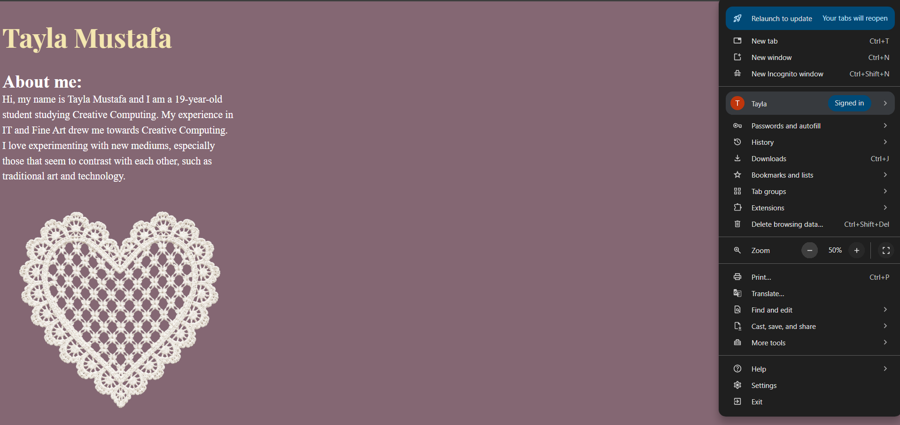

Originally i wanted the heart to be on right to make this happen i moved the image tag avobe the paragraph tag and and added a float right tag to the end of it, this successfully moved the heart to where i was=nted it to be i also added and updated my notsjusty so that mky code is a little easier to navigate 

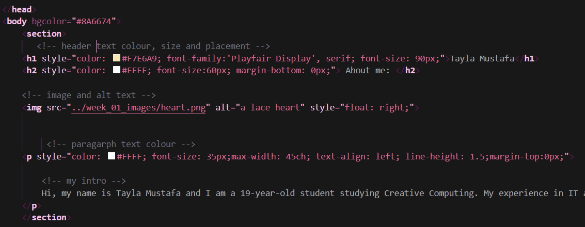

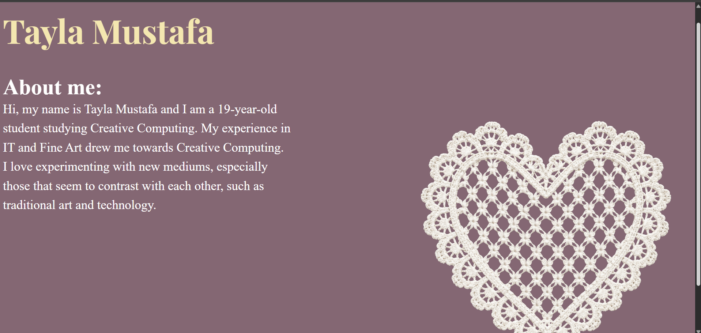

